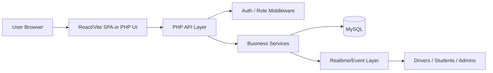

# ARCHITECTURE.md

## System overview
The PHP rewrite of CTMS follows a layered architecture with a web application layer, business logic layer, data access layer, and deployment layer.

## Target architecture


## Layer responsibilities
### Presentation layer
- Handles UI rendering and client requests
- Uses REST endpoints for backend communication

### Application layer
- Controllers and route handlers
- Request validation
- Authentication and authorization
- Response formatting

### Domain layer
- Business logic for buses, routes, students, drivers, announcements, notifications, ETA, and journeys
- Reusable service classes

### Data layer
- Repositories or models for persistence
- Prepared SQL and ORM-based data access
- Migration and seeding support

## Recommended project structure
```text
app/
  Http/Controllers/
  Http/Middleware/
  Models/
  Services/
  Rules/
  Exceptions/
config/
database/
  migrations/
  seeders/
resources/views/
routes/
public/
storage/
tests/
Dockerfile
compose.yaml
nginx.conf
.env.example
```

## Authentication flow
1. User submits login credentials.
2. The auth service validates credentials.
3. The system checks the role and account status.
4. A signed token or session is issued.
5. The request is authorized through middleware.

## Data flow examples
### Login flow
- Client sends email/password/role
- Controller calls auth service
- Service checks DB user record
- Password verification occurs
- Token/session is created and returned

### Bus location update flow
- Driver sends location payload
- Controller validates input
- Service stores or updates record
- Real-time event is broadcast to connected clients

## Deployment architecture
- Reverse proxy: Nginx or Apache
- PHP runtime: PHP-FPM
- Database: MySQL 8
- Optional caching: Redis
- Optional realtime: Laravel Reverb or external WebSocket service

## Production readiness requirements
- Secure environment configuration
- Log rotation and app monitoring
- Health endpoint
- Automated migrations on deployment
- Containerized deployment support
- Backup and restore strategy for MySQL
